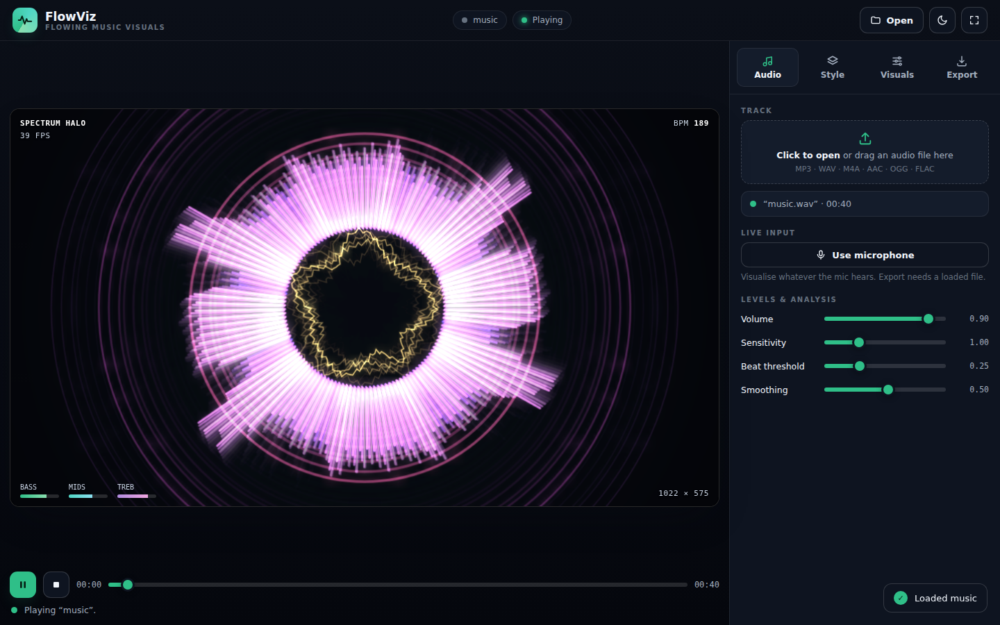

# FlowViz 🎵✨

A **music-reactive visual synthesizer** that creates stunning real-time animations synced to your audio. Choose from 33 dynamic visual styles, customize every parameter, and export high-quality videos.



## Features

- **33 Visual Styles** — Particles, ribbons, geometric patterns, organic growth, synapses, and more. Each style has multiple randomized variations.
- **Real-Time Audio Analysis** — Reacts to bass, mids, and treble independently using Web Audio API FFT analysis.
- **Beat Detection** — Styles respond to musical beats with synchronized pulses, flashes, and bursts.
- **Mood System** — Colors shift and blend across transitions. Each beat pulse adds visual energy.
- **Full Parameter Control** — Adjust amplitude sensitivity, motion speed, trail persistence, particle density, complexity, saturation, and more.
- **Dark & Light Themes** — Toggle between beautiful dark and light modes. Fully responsive design.
- **Microphone Input** — Visualize live audio from your mic. Perfect for streams and performances.
- **Video Export** — Record MP4 or WebM videos up to 4K resolution at 60 fps with audio.
- **Auto-Flow** — Automatically cycle through styles on a timer or on musical beats.
- **Safari & iOS Compatible** — Works on Mac, iPad, and iPhone. Designed for touch interfaces.

## Getting Started

### Quick Start
1. **Open the app**: Visit the [live demo](https://yourname.github.io/FlowViz) or open `index.html` locally.
2. **Load audio**: Click "Choose File" or drag a WAV/MP3 audio file onto the stage.
3. **Play**: Press the Play button to start.
4. **Customize**: Use the Visuals tab to adjust colors, motion, trails, and more.

### Installation (Self-Hosted)
```bash
git clone https://github.com/yourname/FlowViz.git
cd FlowViz
# Open index.html in your browser
```

## Usage

### Audio Input
- **File**: Load local audio files (WAV, MP3, OGG, etc.)
- **Microphone**: Grant permission and visualize live input
- **Seek**: Click the timeline to jump to any point in the track
- **Play/Pause**: Controls playback of the loaded track

### Visual Styles
Select from 33 styles in the **Styles** tab:
- **Particles**: Field-following particles with physics
- **Ribbons**: Flowing ribbons that wrap around beat points
- **Galaxies**: Orbital systems reacting to bass
- **Geometric**: Kaleidoscopes, spirals, and mathematical patterns
- **Organic**: Growing networks, fractal trees, vessel systems
- **Synaptic**: Neurons firing on beat, signal pulses
- **Abstract**: Plasma, aurora, oscilloscopes, and more

Each style returns with **randomized variations** to avoid repetition on long tracks.

### Visuals Tab
Fine-tune the entire visualization:
- **Amplitude**: How sensitive visuals are to audio volume
- **Motion**: Speed of particle/pattern movement
- **Trails**: Fade persistence (0 = no trails, 1 = no fade)
- **Density**: Number of particles/elements
- **Complexity**: Detail level of patterns
- **Saturation**: Color intensity (0 = grayscale, 1 = full color)
- **Hue Shift**: Rotate colors across the spectrum

### Export Tab
Record your visualization as video:
- **Resolution**: 720p, 1080p, 1440p, 2160p (4K)
- **Frame Rate**: 24, 30, 60 fps
- **Duration**: Record full track or a custom length
- **Format**: MP4 (H.264) or WebM (VP9)

Exported files are named: `YYYY-MM-DD FlowViz-[Style]-[Resolution].mp4`

### Auto-Flow
Automatically cycle styles:
- **Enable**: Turn on "Auto-flow" toggle
- **Interval**: Time between style changes (1-10 seconds)
- **On Beat**: Change styles when a beat is detected
- **Transition**: Smooth fade duration between styles

## Settings

All settings persist in browser local storage.

| Setting | Range | Default |
|---------|-------|---------|
| Amplitude | 0.0–2.0 | 1.0 |
| Motion | 0.2–2.0 | 1.0 |
| Trails | 0.0–1.0 | 0.5 |
| Density | 0.0–2.0 | 1.0 |
| Complexity | 0.0–2.0 | 1.0 |
| Saturation | 0.0–1.0 | 1.0 |
| Hue Shift | -180–180° | 0° |
| Transition | 0.1–5.0 s | 0.5 s |

## Browser Support

| Browser | Support |
|---------|---------|
| Chrome 90+ | ✅ Full |
| Firefox 88+ | ✅ Full |
| Safari 15+ | ✅ Full |
| Edge 90+ | ✅ Full |
| Mobile Safari (iOS 15+) | ✅ Full |
| Chrome Mobile | ✅ Full |

**Requirements:**
- Web Audio API (for audio analysis)
- Canvas 2D (for rendering)
- MediaRecorder API (for video export)

## Keyboard Shortcuts

| Shortcut | Action |
|----------|--------|
| `Space` | Play/Pause |
| `T` | Toggle theme (dark/light) |
| `A` | Auto-flow on/off |
| `←` / `→` | Seek backward/forward 5 seconds |
| `M` | Toggle microphone input |
| `R` | Start/stop recording |

## Performance

- **Target**: 60 fps on modern hardware
- **Rendering**: Low-resolution internal canvas (1/2–1/4 screen res) upscaled for performance
- **Audio Analysis**: Real-time FFT with 512-sample frames
- **Mobile**: Optimized for iPad and iPhone; lower resolution on smaller screens

## Technical Stack

### Technologies Used
- **Web Audio API**: Real-time audio input, frequency analysis, playback
- **Canvas 2D**: Rendering visual styles
- **JavaScript (ES2020)**: Core app logic, no external dependencies
- **CSS3**: Responsive design, dark/light themes, animations
- **MediaRecorder API**: Video export with audio

### No Dependencies
FlowViz is a **self-contained HTML file** with **zero external dependencies**. It runs entirely in your browser with no build step required.

## Architecture

### Modules
- **AudioEng**: Web Audio API wrapper, analysis, playback control
- **Styles**: 33 visual style definitions
- **Flow**: Style scheduling and transitions
- **Mood**: Color system, hue shifting, beat-driven color pulses
- **Frequencies**: Spectrum analysis (bass, mids, treble extraction)
- **App**: Main render loop, FPS counter, HUD
- **UI**: Controls, tabs, file picker, export dialog

### Key Algorithms
- **Perlin Noise**: Organic motion in nebula, aurora, and plasma
- **Strange Attractors**: Chaos-driven particle orbits
- **FFT Analysis**: Frequency spectrum to visual energy
- **Bezier Paths**: Smooth curves for ribbons and trails
- **Fractal Recursion**: Self-similar tree branching

## Customization

### Modifying Styles
Each style is a JavaScript object with `enter()`, `setup()`, and `draw()` methods:

```javascript
Styles.customStyle = {
  name: 'My Style',
  enter() {
    // Reset/initialize on style load
  },
  draw(ctx, w, h, dt, s) {
    // Render frame
    // ctx: Canvas 2D context
    // w, h: Canvas dimensions
    // dt: Delta time (seconds)
    // s: Scale factor (2x on high-DPI displays)
  }
};
```

Use `F.beat`, `F.bass`, `F.mid`, `F.treb`, `F.spec[]` for audio data.
Use `P.*` for user control parameters.
Use `Mood.c(hue, saturation, brightness)` for theme-aware colors.

### Adding New Styles
1. Copy the structure above
2. Add to the `Styles` object
3. Add name to the `ORDER` array to make it visible

## Licensing

### FlowViz License
FlowViz is released under the **MIT License** — see [LICENSE](LICENSE) for details.

You are free to use, modify, and distribute this software for personal or commercial purposes.

### Third-Party Acknowledgments

FlowViz uses the following browser APIs (no external libraries):

- **Web Audio API** — W3C specification, built into all modern browsers
- **Canvas 2D** — HTML5 standard, no external library
- **MediaRecorder API** — W3C standard, native browser support

All algorithms are original implementations.

## Contributing

Contributions are welcome! See [CONTRIBUTING.md](CONTRIBUTING.md) for guidelines.

### Ideas for Enhancement
- Additional visual styles
- Audio visualization themes (Spotify, Soundcloud, YouTube integration)
- Touch-friendly mobile UI improvements
- WebGL version for advanced effects
- MIDI controller support
- Animation export (GIF, WebM keyframe optimization)

## Troubleshooting

### No Sound Playing
- **Browser autoplay policy**: Click the Play button and approve audio when prompted
- **Microphone mode**: If using the microphone, make sure you granted browser permission
- **Muted browser tab**: Some browsers mute audio until clicked

### Slow Performance
- Lower the resolution slider in Visuals
- Reduce Density and Complexity parameters
- Close other browser tabs
- Use Chrome/Edge (faster than Firefox/Safari on some machines)

### Export Not Working
- Check browser support: Chrome, Firefox, Safari 15+, Edge
- Ensure the track is loaded and at least a few seconds long
- Try a different export resolution
- Clear browser cache and refresh

### Visual Artifacts
- Update your browser to the latest version
- Clear browser cache
- Try a different visual style
- Disable browser extensions that modify the page

## Roadmap

- [ ] WebGL rendering pipeline for advanced effects
- [ ] Adjustable color palettes and themes
- [ ] MIDI / OSC input support
- [ ] Preset save/load system
- [ ] Collaborative mode (share live stream)
- [ ] VR/immersive mode

## Credits

**Created by**: You  
**Last Updated**: October 2026

## Support

For bugs, feature requests, or questions:
- Open an [issue](https://github.com/yourname/FlowViz/issues)
- Check the [manual](docs/USER_MANUAL.md) for detailed usage

---

**Enjoy the show.** 🎵✨
