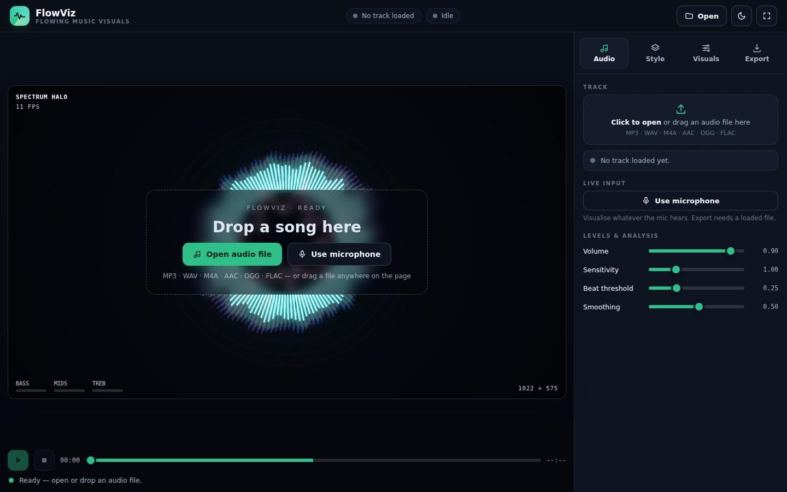
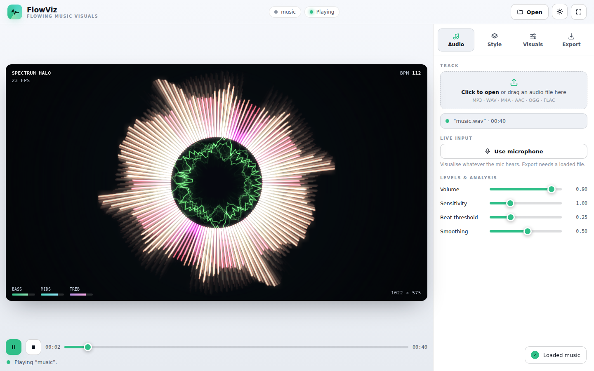
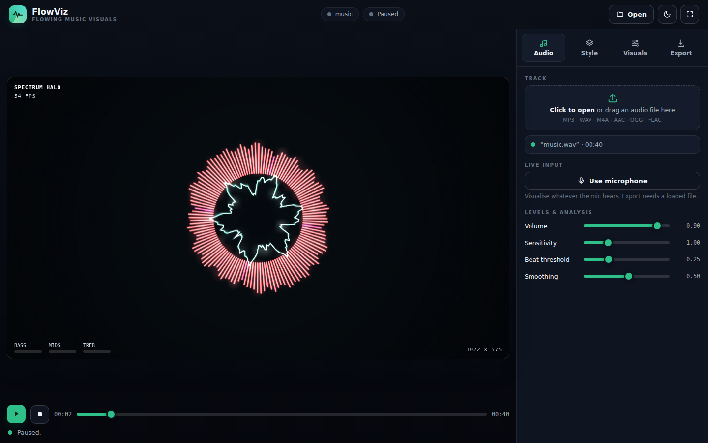
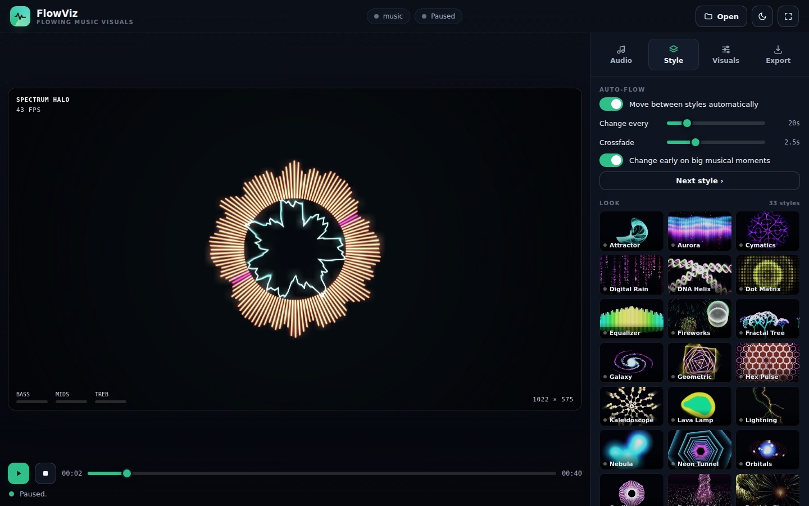
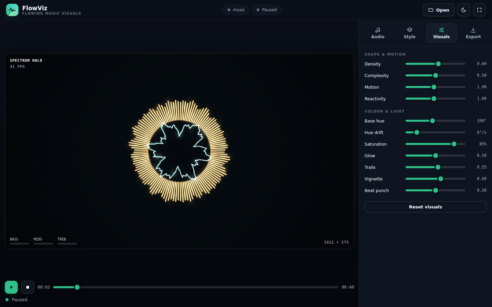
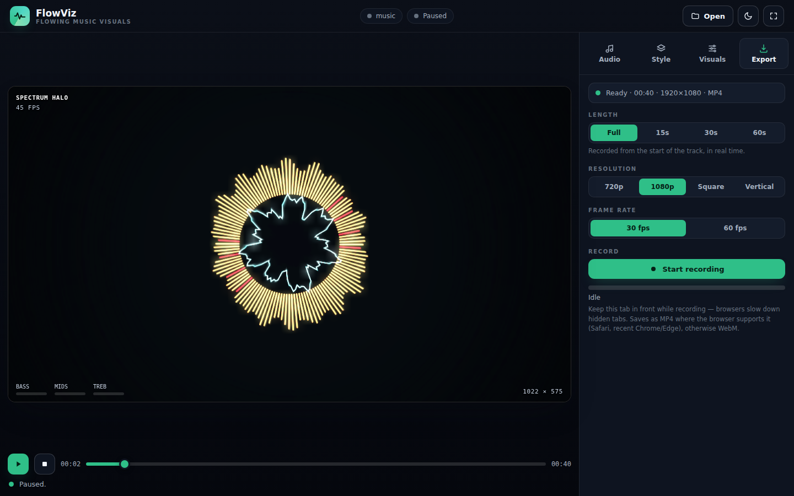

# FlowViz User Manual

Complete guide to using FlowViz, with detailed screenshots of each feature.

## Table of Contents

1. [Getting Started](#getting-started)
2. [Loading Audio](#loading-audio)
3. [Visual Styles](#visual-styles)
4. [Customization](#customization)
5. [Recording & Export](#recording--export)
6. [Tips & Tricks](#tips--tricks)

---

## Getting Started

### Launch the App

Open `index.html` in your web browser, or visit the live version. You'll see the **idle state** with a welcome message.

The interface consists of:
- **Stage (left)**: Canvas where visuals are rendered
- **Controls (right)**: Tabbed interface for Styles, Visuals, and Export
- **Top bar**: Play/pause, theme toggle, status indicators, file input
- **Meters (bottom left)**: Real-time bass, mids, and treble levels

### Theme Toggle

Click the moon/sun icon in the top bar to switch between dark and light modes. Your choice is remembered.

---

## Loading Audio

### From a File

1. Click **"Choose File"** or drag a WAV/MP3 file onto the stage
2. FlowViz supports: WAV, MP3, OGG, FLAC, and other Web Audio formats

Once loaded, you'll see:
- Track title and duration in the top bar
- Seek timeline at the bottom
- Status changes to "Paused"

### From Microphone

1. Click the **microphone icon** in the top bar
2. Grant browser permission when prompted
3. Status changes to "Microphone"
4. Visuals react to live audio input in real time

### Playing the Track

Click the **Play button** (▶) to start playback. The status changes to "Playing" and visuals begin to react to the music.

The meters at the bottom left show real-time audio analysis:
- **Bass** (green): Low frequencies
- **Mids** (cyan): Mid frequencies  
- **Treble** (purple): High frequencies

---

## Visual Styles

### Browsing Styles

Click the **Styles** tab to see all 33 visual styles in a grid. Each style has a live preview thumbnail.

### Style Categories

**Particles & Physics**
- Particle Flow: Momentum-based particles with a drifting vortex
- Particle Column: Spiraling particles rising in a rotating column

**Ribbons & Paths**
- Ribbon Fountain: Ribbons flowing and spreading on beats
- Ribbon Spiral: Flowing helix synchronized to beat
- Trail System: Particle trails responding to energy

**Geometric**
- Spirograph: Lobed patterns with customizable ratios
- Kaleidoscope: Mirrored geometric formations
- Tunnel: Expanding rings creating depth

**Organic Growth**
- Vessel Growth: Branching capillaries filling a body shape
- Fractal Tree: Multi-layered forest with randomized genetics
- Synapse: Neural cells firing and connecting

**Space & Cosmos**
- Galaxy: Orbital particles around a central attractor
- Nebula: Perlin noise clouds with color bands
- Stars: Twinkling points with depth and motion

**Abstract**
- Plasma: Plasma-like patterns with wave propagation
- Aurora: Shimmering curtains of light
- Cymatics: Chladni patterns responding to frequencies
- Oscilloscope: Waveform visualization with glow

...and 19 more unique styles.

### Style Variations

Each time a style loads, it generates **random variations**:
- Different colors (via Mood system)
- Different parameter seeds (branches, orbits, etc.)
- Different complexity levels

This ensures **long music tracks don't feel repetitive**.

---

## Customization

### Visuals Tab

Click the **Visuals** tab to adjust how the styles look and behave.

#### Parameter Controls

**Amplitude** (0.0–2.0, default 1.0)
- How sensitive visuals are to audio volume
- Higher = more dramatic response to quiet sounds
- Lower = subtler reactions, needs louder music

**Motion** (0.2–2.0, default 1.0)
- Speed of particle movement and pattern animation
- Higher = faster movement, more frantic
- Lower = slower, more graceful motion

**Trails** (0.0–1.0, default 0.5)
- Persistence of motion trails and ghosting
- 0.0 = no trails, crisp and clean
- 1.0 = maximum trails, glowing ghosts everywhere

**Density** (0.0–2.0, default 1.0)
- Number of particles or visual elements
- Higher = more crowded, more detail
- Lower = sparse, cleaner look

**Complexity** (0.0–2.0, default 1.0)
- Detail level and randomness of patterns
- Higher = more intricate structures
- Lower = simpler, more uniform patterns

**Saturation** (0.0–1.0, default 1.0)
- Color intensity
- 0.0 = grayscale (black & white)
- 1.0 = full vibrant colors

**Hue Shift** (-180–180°, default 0°)
- Rotate all colors around the color wheel
- 0° = default colors per style
- ±60° = noticeable shift
- ±180° = inverted colors

#### Beat-Driven Features

When a beat is detected:
- Particles burst outward
- Trails light up and glow
- Colors pulse brighter
- Complexity increases momentarily

---

## Recording & Export

### Export Tab

Click the **Export** tab to record videos.

### Export Settings

**Resolution**
- 720p (1280×720): Fast, small files
- 1080p (1920×1080): Standard, recommended
- 1440p (2560×1440): High quality
- 2160p (4K, 3840×2160): Ultra high quality

**Frame Rate**
- 24 fps: Cinematic, smallest file
- 30 fps: Smooth, balanced
- 60 fps: Ultra smooth, larger files

**Duration**
- Custom: Record a specific length (1–60 seconds)
- Full Track: Export entire audio file

**Format**
- MP4 (H.264): Best compatibility, smaller files
- WebM (VP9): Open format, better compression

### Recording a Video

1. Load an audio track (file or microphone)
2. Go to the **Export** tab
3. Choose resolution, frame rate, and duration
4. Click **"Start Recording"**
5. A confirmation dialog appears with the export details
6. Click **"Start recording"** to begin
7. Keep the browser tab in focus until recording finishes
8. The video downloads automatically when done

**Filename Format**:  
`YYYY-MM-DD FlowViz-[Style]-[Resolution].mp4`

Example: `2026-10-24 FlowViz-Galaxy-1080p.mp4`

### Tips for Export

- **Best quality**: 1440p or 4K at 60 fps (larger file, longer to render)
- **Web sharing**: 1080p at 30 fps (balanced quality and file size)
- **Quick preview**: 720p at 30 fps (fast, smallest file)
- **Keep tab active**: Don't minimize or switch tabs during recording
- **Ensure audio**: Check that audio is playing before recording
- **Disk space**: 4K at 60 fps uses ~1 GB per minute of video

---

## Tips & Tricks

### Performance Tuning

If the app is slow:

1. **Reduce visual density**:
   - Lower Density slider
   - Lower Complexity slider
   - Choose simpler styles (Geometric, Stars)

2. **Reduce resolution**:
   - If exporting, use 720p instead of 4K
   - The app's internal rendering is fixed; this only affects export

3. **Check other apps**:
   - Close browser tabs and background apps
   - Use Chrome/Edge for best performance
   - Disable browser extensions

### Color Customization

**Saturation tricks**:
- Set Saturation to 0 for **black & white visualizations**
- Great for professional/minimalist look

**Hue rotation**:
- Rotate hue by ±60° for a **complementary color scheme**
- Use ±180° for **inverted colors**
- Different hue per export for a **color series**

### Music Selection

**Best for FlowViz**:
- EDM, electronic, synthwave (clear beats)
- Ambient, soundscapes (organic motion)
- Classical, orchestral (dynamic contrast)
- Lo-fi, chill beats (smooth constant motion)

**Challenging for FlowViz**:
- Speech, podcasts (no clear beat)
- Loud compression (less dynamic range)
- Very quiet recordings (boost volume first)

### Creating Series

1. Export the same style in **3 different hue rotations** (0°, ±120°)
2. Use different **amplitude settings** for varied intensity
3. Combine with **different visual styles** for a collection

### Keyboard Shortcuts

| Key | Action |
|-----|--------|
| `Space` | Play/Pause |
| `T` | Toggle dark/light theme |
| `A` | Toggle auto-flow |
| `M` | Toggle microphone input |
| `R` | Start/stop recording |
| `←` / `→` | Seek ±5 seconds |

### Auto-Flow Mode

The **Auto-flow** toggle (top right of Styles tab) cycles through styles automatically:

1. Enable "Auto-flow"
2. Set **Interval** (time between changes): 1–10 seconds
3. Toggle **On Beat** to sync changes to musical beats
4. Set **Transition** duration for smooth fades

This is great for long tracks or livestreams.

---

## Troubleshooting

### I Don't Hear Sound

**Browser is blocking autoplay:**
- Click the Play button again
- Approve audio when the browser asks
- The button pulses red if audio is blocked

**Microphone mode:**
- Check browser permissions (camera/microphone)
- Try a different app first to verify mic works
- Grant permission when prompted

### The Visual Reacts Slowly

This means the **amplitude sensitivity is too low**:
- Increase the **Amplitude** slider (0.5 → 1.0 → 1.5)
- The meter bars should be bouncing visibly

Or the **track is very quiet**:
- Boost volume in your audio player or system settings
- Re-load the track after boosting

### Export Is Taking Forever

**This is normal for high resolution/frame rates:**
- 4K 60 fps can take 30–60 seconds for 10 seconds of video
- Don't close the browser tab
- Check Task Manager to see if CPU/GPU is active

To speed up:
- Reduce resolution to 1080p
- Reduce frame rate to 30 fps

### The App Feels Laggy

1. Lower **Density** and **Complexity**
2. Reduce the number of styles in auto-flow rotation
3. Close other browser tabs
4. Use Chrome or Edge (faster than Safari/Firefox)
5. Check if other apps are using CPU/GPU

### Export Button Is Disabled

**MediaRecorder is not supported:**
- Use Chrome, Firefox, or Safari 15+
- Some Chromium-based browsers may not support this
- Try a different browser

---

## FAQ

**Q: Can I use these videos commercially?**  
A: Yes. Your exports are your content. FlowViz is under the MIT license.

**Q: Can I extract the audio from an export?**  
A: Yes, the exported MP4/WebM contains the original audio track.

**Q: Why does the visual style change each time I load it?**  
A: Styles generate **random variations** on each load. This prevents repetition in long tracks. You can reload the same style to get a different variation.

**Q: Can I save my current settings?**  
A: Yes, all sliders and parameters are auto-saved to your browser's local storage.

**Q: Does this work offline?**  
A: Yes, completely offline. No internet required.

**Q: Can I use this with YouTube streams?**  
A: Not directly (browsers block capturing external content), but you can:
1. Download the track locally
2. Use OBS to record FlowViz output
3. Combine with YouTube audio via external software

**Q: What's the file size for typical exports?**  
- 720p 30fps: ~50 MB per minute
- 1080p 30fps: ~150 MB per minute
- 1440p 60fps: ~500 MB per minute
- 4K 60fps: ~1.5 GB per minute

---

## Next Steps

- Browse all 33 styles and find your favorites
- Experiment with amplitude and motion settings
- Try exporting a short 10-second clip
- Create a color series with hue rotations
- Use auto-flow for hands-free visualization during streams

**Enjoy!** 🎵✨
